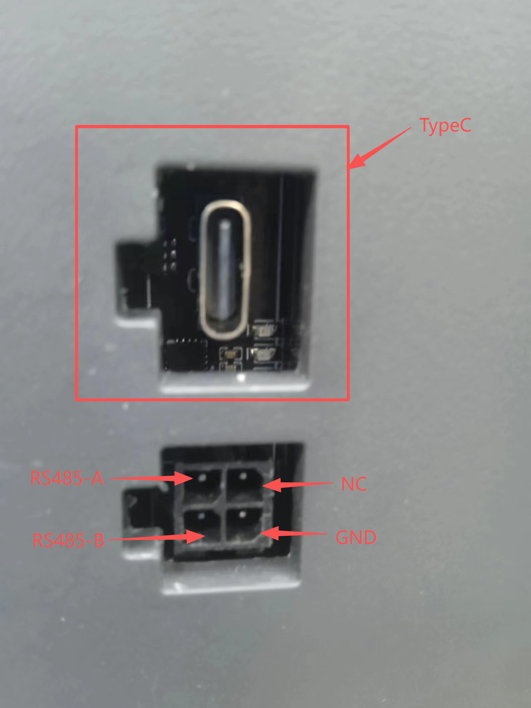

# Introduction
This article covers the use of the ACE2 Pro with official Klipper firmware, using a Voron 2.4 300 as the test machine.

# Install
```bash
cd ~
git clone -b dev https://github.com/FYSETC/ACEPRO.git
source ~/klippy-env/bin/activate
pip3 install pyserial --upgrade

ln -sf ~/ACEPRO/extras/ace ~/klipper/klippy/extras/ace
ln -sf ~/ACEPRO/extras/virtual_pins.py ~/klipper/klippy/extras/virtual_pins.py
ln -sf ~/ACEPRO/extras/temperature_ace.py ~/klipper/klippy/extras/temperature_ace.py

cp ~/ACEPRO/config/printer_generic_macros.cfg ~/printer_data/config/
cp ~/ACEPRO/config/ace_macros_generic.cfg ~/printer_data/config/

cp ~/ACEPRO/config/ace.cfg ~/printer_data/config/
cp ~/ACEPRO/config/ace_voron.cfg ~/printer_data/config/
cp ~/ACEPRO/config/ace_user.cfg ~/printer_data/config/
cp ~/ACEPRO/config/ace_vars.cfg ~/printer_data/config/
cp ~/ACEPRO/config/ace_macros_generic.cfg ~/printer_data/config/
```

# Config
Add the following to the end of your existing `printer.cfg`:
```ini
[include printer_generic_macros.cfg]
[include ace_voron.cfg]
[include ace_user.cfg]
```

You need to re-implement the following content from the ace.cfg file.
```bash
[filament_switch_sensor extruder_sensor]  # switch_pin
```

You need to re-implement the following content from the ace_user.cfg file.
```bash
[gcode_macro POOP] # Clean the nozzle after feeding material
[gcode_macro CUT_TIP] # Material Return and Cutting Macro
[gcode_macro G9111]
```

You need to re-implement the following content from the ace_voron.cfg file.
```bash
[ace] # Check each setting based on the specific conditions of the machine
```

# Orca Slicer Integration
## Update Start G-code

Update your Orca slicer start machine-gcode to provide the initial_tool parameter to G9111 macro:
```
G9111 bedTemp=[first_layer_bed_temperature] extruderTemp=[first_layer_temperature[initial_tool]] tool=[initial_tool] SKIP_PURGE_FOR_ALREADY_LOADED_TOOL=1
```

**Parameters:**
- `bedTemp` - Bed temperature
- `extruderTemp` - Nozzle temperature for the initial tool
- `tool` - Initial tool index (from `[initial_tool]` Orca variable)
- `SKIP_PURGE_FOR_ALREADY_LOADED_TOOL` - (Optional) Skip purge if the same tool is already loaded and detected at nozzle. This saves time on print restarts. Set to `0` to always purge.

## Update End G-code

Update your Orca slicer end machine-gcode to call PRINT_END macro:
```
PRINT_END CUT_TIP=1
```
This will ensure that at print end, the ACE Pro driver (if available) is informed of the print end, the filament is cut and retracted, and the printhead moves to the park position.
If you prefer to NOT get the filament cut at print end, change CUT_TIP argument to zero:
```
PRINT_END CUT_TIP=0
```

# Connection
Install the USB-to-RS485 adapter board manufactured by FYSETC, and use a USB cable to connect the Klipper host to the adapter board's Type-C port.
<p align="left">
  
</p>